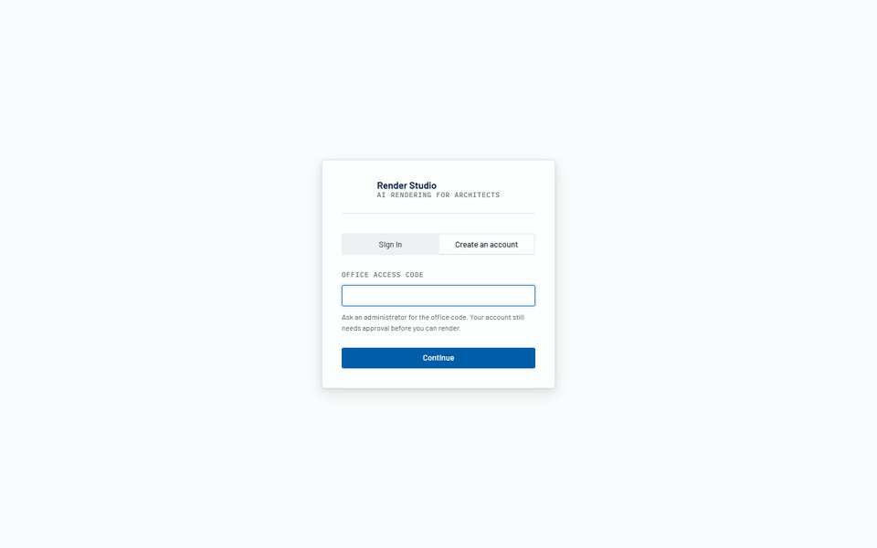
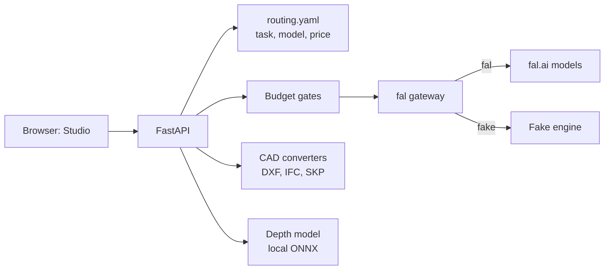
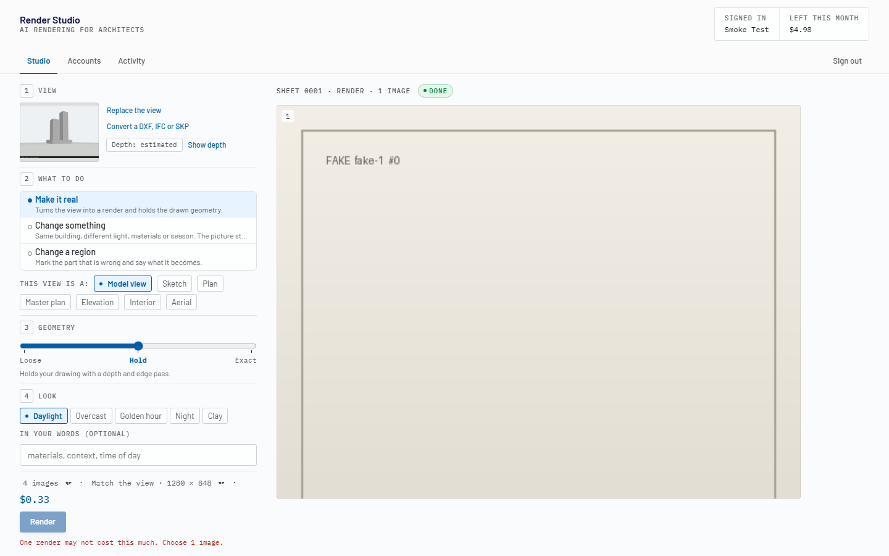

# Render Studio

Architects lose days turning a model view, a sketch or a CAD plan into a presentation image, and AI render tools give no control over what they spend or how much they change the drawing. Render Studio sends your view to image models on fal.ai, holds the drawn geometry with depth and edge conditioning, and refuses jobs that would pass a per-render, per-person or monthly budget.



*Synthetic massing view in, four labelled placeholder sheets out, with the fake engine (no key, no cost).*

## Quickstart

Zero-key path first. `RENDER_ENGINE=fake` runs the whole job flow (queue, budget, sheets) and returns labelled placeholder images. It makes no network calls and spends nothing.

If you switch between the fake and the real engine, use a separate database and data directory for each (`DB_PATH` and `DATA_DIR` in `.env`), so fake jobs do not count against the real budget cap.

### Docker

```bash
cp .env.example .env
RENDER_ENGINE=fake docker compose up -d --build
curl -f http://localhost:8000/api/health
bash scripts/smoke_fake.sh        # signs up, uploads an image, runs one fake render
docker compose down -v            # stop and delete the data volume
```

PowerShell:

```powershell
Copy-Item .env.example .env
$env:RENDER_ENGINE = "fake"; docker compose up -d --build
curl.exe -f http://localhost:8000/api/health
docker compose down -v
```

The first build takes several minutes. Open <http://localhost:8000>, choose "Create an account", enter the access code from `.env` (`OFFICE_ACCESS_CODE`, default `change-me`), then sign up with `admin@example.test` (`ADMIN_EMAIL`). The first account on that address is the administrator. Try `examples/inputs/massing-street.png`.

### Local (Python 3.11 or newer with uv, Node 20)

```bash
uv sync
(cd web && npm ci && npm run build)
RENDER_ENGINE=fake OFFICE_ACCESS_CODE=change-me ADMIN_EMAIL=admin@example.test \
  uv run uvicorn api.main:app --port 8000
uv run python -m pytest -q
```

PowerShell:

```powershell
uv sync
cd web; npm ci; npm run build; cd ..
$env:RENDER_ENGINE = "fake"; $env:OFFICE_ACCESS_CODE = "change-me"; $env:ADMIN_EMAIL = "admin@example.test"
uv run uvicorn api.main:app --port 8000
uv run python -m pytest -q
```

### Real renders (bring your own key)

Set `FAL_KEY` in `.env` (create a key at fal.ai/dashboard/keys) and start without `RENDER_ENGINE`. The key stays on the server. Every render costs real money on your fal account. Prices in `routing.yaml` carry a "priced on" date and drift, so check fal.ai.

## What it does



- Takes a model view, sketch, plan, elevation, master plan, interior or aerial view and returns up to four renders per sheet.
- Picks the model from `routing.yaml`, a lookup table. The browser never names a model.
- Holds the drawing with a Loose / Hold / Exact slider that sets depth and edge conditioning strength.
- Estimates depth locally with Depth Anything V2 Small (ONNX). Without the model the Exact setting is capped at Hold.
- Converts DXF (layer picker), IFC (clay view and true depth) and SketchUp SKP files into a view to render.
- Edits: change light, materials or season; mark a region and say what it becomes; enlarge.
- Budget gates run in this order before any job is reserved: kill switch, per render (`BUDGET_PER_JOB_USD`), per person per month (`BUDGET_PER_USER_USD`), whole app per month (`BUDGET_MONTHLY_USD`). The reservation is one atomic write.
- Accounts: a shared access code opens signup, an administrator approves, passwords use argon2id.



*The per-render cap in action: four images estimate above the cap, so the app asks for one.*

More: [architecture](docs/ARCHITECTURE.md), [task status](docs/TASKS.md), [Docker notes](docs/DOCKER.md).

## Tasks

12 of 14 tasks are on, 2 are experimental. Experimental tasks are hidden and refused unless `ENABLE_EXPERIMENTAL_TASKS=1`.

| Task | Status |
|---|---|
| `massing_to_render`, `variation`, `inpaint`, `upscale` | on; checked with paid runs on the final code in the private deployment |
| `masterplan_prettify`, `floorplan_prettify`, `interior_to_render` | on; not re-checked on the final code |
| `aerial_view_render` | on; proportions can drift, check the massing |
| `sketch_to_render` | on; the proven engine is weaker on sketches |
| `elevation_section_render` | on; roofs can be invented |
| `relight`, `edit_with_reference` | on, API-only (`POST /api/renders`, no UI card) |
| `entourage` | experimental; partial results, API-only |
| `skp_material_render` | experimental; worked on one model and one camera |

## Models and licences

The 13 allowlisted endpoints are listed in `routing.yaml` (FLUX schnell, dev, pro, Kontext, general, fill and LoRA, FLUX.2 Pro edit, Nano Banana Pro edit, Clarity and SeedVR upscalers, Seedream edit). FLUX.1 [dev]-based endpoints carry non-commercial terms when self-hosted. On fal.ai you use them under your own fal account terms. Depth Anything V2 Small is Apache-2.0 and is downloaded by `scripts/fetch_depth_model.py` with a pinned SHA-256, not bundled.

## What is synthetic

Everything in `examples/inputs/` is invented: a three-volume massing (axonometric, street view, pencil sketch, elevation), a three-room DXF plan and a one-storey IFC. Each image carries a caption strip saying so. Regenerate them:

```bash
uv run python examples/make_sample.py --out examples/inputs
```

The screenshots and GIF in `docs/media/` were taken against the fake engine, so the "renders" in them are labelled placeholders. No real render ships. Details per file: [examples/README.md](examples/README.md).

## Status

Ran in the original private deployment: the paid FLUX/Kontext render tasks in the table above, the account gate and the budget guardrails, with real fal.ai jobs.

Experimental here: `entourage` and `skp_material_render`; IFC and SKP clay previews inside Docker (OSMesa, best effort; the test suite runs on the host); the Docker packaging itself.

Recorded in this edition (fake engine, no real fal job was run):

- `uv run python -m pytest -q`: 633 passed, 10 skipped, 0 failed (after the web build; without `web/dist` one more test is skipped).
- `RUN_E2E=1 uv run python -m pytest tests/e2e -q` (headless Chromium, fake engine): 9 passed. This holds without the optional depth model: the view-loading test accepts either of the two chips the UI can show ("Depth: estimated" with the model fetched via `scripts/fetch_depth_model.py`, "Edges only" without it).
- `ruff check app api tests examples`: clean.
- `docker compose up` with `RENDER_ENGINE=fake`: health check returns 200 and `scripts/smoke_fake.sh` finishes one render.

## Origin

Built for internal use at an engineering consultancy; this edition is cleaned and runs on synthetic data.

## Licence

MIT, see [LICENSE](LICENSE). Third-party notices, including PyMuPDF (AGPL-3.0) and ifcopenshell (LGPL), are in [NOTICE](NOTICE).
