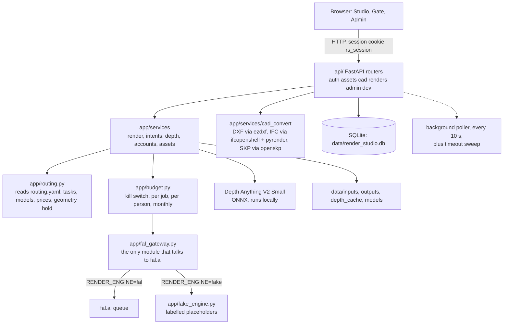

# Render Studio: architecture

Schema version 9. Read this before changing anything structural. Quickstart and task status are in the [README](../README.md) and [TASKS.md](TASKS.md).

---

## 1. Decisions

| Decision | Choice | Consequence |
|---|---|---|
| Hosting | One small host, plain HTTP, Docker or local | Meant for a trusted network or behind your own HTTPS proxy. See section 13. |
| Front end | React, Vite and TypeScript, in `web/` | Built into `web/dist`; FastAPI serves it. |
| Back end | FastAPI, serving the API and the built bundle | One process. No Node at runtime. |
| Job queue | fal.ai's own queue, polled from SQLite | No Redis, no worker, no webhook URL. |
| Engine | One seam, `app/fal_gateway.py`, with a fake engine behind it | Zero-spend development with the same job lifecycle. |
| Model choice | `routing.yaml`, a lookup table, not a model | Predictable and testable; changing a model is a config edit. |
| Accounts | Shared access code, self-signup, administrator approval | Nobody can spend until an administrator approves them. |
| Email | Never sent | An email address is a label, not a proven identity. |
| Database | SQLite in WAL mode, one connection per thread | Right for one small team. Revisit well past 50 concurrent users. |
| Schema changes | Numbered, append-only steps in `app/migrations.py` | Applied at startup; shipped steps are never edited. |

---

## 2. Components



`app/routing.py` loads `routing.yaml` once and is the only place that turns a task or an intent into a model, a payload shape, a price and a set of conditioning scales.

---

## 3. The request path

### 3.1 Submit a render

```
POST /api/renders  {intent, view, style, line, references, mask_asset_id, geometry_hold, width, height, num_images}
  1  rate limit (render_submit, per account)
  2  intents.plan_intent          intent + view -> task, engine
                                  style + scaffold + line -> prompt
                                  count (1 or 4) and geometry hold (slider, intents that have one)
                                  picture roles and mask rules -> plain sentences on refusal
  3  render.submit_render         resolve the route and its payload spec
                                  check the reference count against max_images
                                  upload or reuse each reference (sha256 and fal_url cached)
  4  depth step                   if the route conditions on depth and the caller sent none:
                                    estimate depth from the geometry picture (cached by source hash),
                                    ingest it as a control asset, depth_source = "estimated";
                                    on any estimator failure, depth_source = "none"
                                  geometry hold: scales from routing.yaml's snaps;
                                    above 50 with no depth source, capped at 50 with a note
  5  fal_gateway.submit           refuse fake:// URLs under the fal engine
                                  upload the base image
                                  build_arguments() from the payload spec
                                  idempotency key (hash of arguments; optional retry salt)
                                  budget.reserve_within_budget(): kill switch, per job,
                                    per person, per month, in that order, as one write
                                  reservation row = status "reserved"
                                  client.submit()  -> request_id, status "queued"
                                  on a failure after the reservation, the row is failed, never left reserved
  6  response: job_id, est_usd, duplicate, depth_source, notes
```

Intent fields, the final geometry hold and the depth source are stored in `jobs.params_json` next to the arguments that fal.ai received. They are not sent to fal.ai and not part of the idempotency key.

Refusals are answered with one sentence: `IntentError` and `RoutingError` map to 422 and 400, and a `RenderRefused` carries its reason from `budget`.

### 3.2 Poll a render

```
background poller (every 10 s)  or  POST /api/renders/refresh  (the Studio's manual refresh; rate limited, never run twice at once)
  render.refresh -> fal_gateway.poll_all
    1  for every pending job: poll()           status from fal, then the result if complete
    2  expire_stale_jobs()                     only jobs still in flight after JOB_TIMEOUT_S
```

`poll()` on a completed job downloads each image, writes one `job_outputs` row per image (index 0 also goes to `jobs.output_path` and `jobs.output_url`, so older readers still work), and marks the job `completed`. A download that fails leaves the job `in_progress`, and the next poll fetches only the missing indexes. A job is never completed with an image missing.

### 3.3 Serve a result

`GET /api/renders/{id}/image?i=N` streams saved image `N`. The `outputs` list on each job gives its `url` (`/api/renders/{id}/image?i=N`), or null when the file is gone. A job that failed or timed out has no outputs.

### 3.4 Retry

`POST /api/renders/{id}/retry` sends a failed job through `submit_render` again with the same task, engine, prompt, size, count, mask, control images (recovered from the stored payload) and geometry hold. The new job carries `retry_of_job_id`. Refusals: 404 for an unknown job, 403 when the caller neither owns the job nor is an administrator, and 409 when the job is not failed or a live retry already exists.

---

## 4. The timeout sweep, in order

Every tick, `poll_all` runs in this order, and the order is the point:

1. **Poll every pending job first.** A render that fal.ai finished between two ticks is downloaded and saved, not failed.
2. **Then expire.** Only jobs still in flight (`reserved`, `queued`, `in_progress`) whose `created_at` is older than `JOB_TIMEOUT_S` (480 seconds by default) are expired.
3. **Each expiry is best-effort upstream.** The request is cancelled with fal.ai if the client supports it. A failure there is logged and does not stop the expiry.
4. **Each expiry is one transaction.** The job becomes `failed` with "Timed out after 8 minutes. Retry sends it again." and `timed_out_at` is set. The budget reservation is released through the same path as a submit failure, so the monthly cap is not held by a dead render.
5. **A failed expiry does not stop the tick.** The job stays in flight and the next tick tries again.

A render that fal.ai completes after it has been expired is not collected. That is the trade the timeout makes, and Retry is the way back.

`poll_all` is guarded so that only one poll runs at a time. A caller that arrives during a poll, or within a short interval of the last one, gets the most recent result.

---

## 5. Database connections

**Rule: a `sqlite3.Connection` belongs to the thread that opened it.**

- `api/deps.py` gives each thread its own connection, opened lazily through `threading.local`, with `db.connect` setting WAL, a 30-second busy timeout and foreign keys on each one.
- The poller and the lifespan call `get_conn()` from inside their own worker threads, never once at startup and shared.
- `close_conn()` closes every connection ever opened on shutdown, and bumps a generation counter so a restarted lifespan opens fresh ones.
- `db.transaction` takes a process-wide re-entrant lock and issues `BEGIN IMMEDIATE`, so writers are serialised across connections. A nested call joins the outer transaction.

Why: one connection used from several threads raised `InterfaceError` and returned corrupted cursors. The Studio saw spurious 401 and 404 errors whenever four image tiles loaded together.

Test overrides of `deps.get_conn` still work, and `tests/test_concurrent_connections.py` covers the per-thread behaviour.

---

## 6. The fake engine seam

`app/fal_gateway.py` is the only module that imports `fal_client`. Every call goes through `_client(settings)`:

```
_client(settings)
  RENDER_ENGINE=fal   -> the fal_client module
  RENDER_ENGINE=fake  -> a process singleton, FakeFalClient (app/fake_engine.py)
```

`FakeFalClient` implements `upload_file`, `submit`, `status`, `result` and `cancel`, with the same return types as the real client. Its status walks Queued for the first half of `FAKE_ENGINE_DELAY_S`, then InProgress, then Completed. Its images are labelled placeholders at the size the request asked for, and their URLs use the `fake://` scheme, which only the fake engine can read.

Safeguards:

- Under the fal engine, a stored `fake://` URL counts as absent, so the image is re-uploaded; a `fake://` reference in a submit is refused with a sentence before anything is priced.
- `fal_key` is not required in fake mode, and `/api/health` reports `"engine": "fake"`. Startup logs a warning.
- `POST /api/dev/fail-next` is registered always, but answers 404 unless the fake engine is running. It is also admin only. It makes the next fake request come back with no image.
- Fake state lives in memory. A restarted server forgets its requests, and the gateway treats the resulting "not found" as an expired request, so the job fails rather than hanging.

Use a separate database and data directory for the fake engine (see the README). Fake jobs carry real estimated costs in the ledger, so a shared database would count them against the real cap.

---

## 7. Data

```
users ──< sessions
  │
  ├──< jobs ──< job_inputs >── assets
  │     │  └──< job_outputs          (one row per image, unique (job_id, idx))
  │     └──< jobs                    (parent_job_id: the edit tree;
  │                                    retry_of_job_id: the failed job a retry replaces)
  ├──< projects ──< assets           (kept in the schema; the UI no longer uses it)
  └── app_settings                   (kill switch and cap overrides, with who changed them)
```

**`jobs`** is also the spend ledger. Its status is one of `reserved`, `queued`, `in_progress`, `completed`, `failed`, `refused`, `cancelled`. Its columns include `username`, `user_id`, `task`, `model_id`, `engine`, `request_id`, `est_usd`, `actual_usd`, `params_json` (intent fields, geometry hold, image size, arguments), `input_path`, `output_path`, `output_url`, `output_seed`, `error`, `parent_job_id`, `root_job_id`, `mask_asset_id`, `depth_source`, `retry_of_job_id`, `timed_out_at`, `created_at` and `updated_at`.

**`job_outputs`** holds every image a job produced. `idx` is its position from 0, `path` its local file, `url` the fal.ai CDN URL and `seed` its seed. Migration 8 backfilled index 0 for each job that already had an output.

**`assets`** are content-addressed by `sha256`. Their kinds are `upload`, `render_output`, `mask`, `control` (a depth or change map), `cad_upload` (the raw DXF, IFC or SKP, kept for re-conversion, never a render input) and the reference roles that a render can name: `geometry`, `style`, `material`, `context`, `entourage`, `mask`. `fal_url` is cached so the same image is uploaded to fal.ai once.

**Migrations** (`app/migrations.py`, `SCHEMA_VERSION = 9`):

| # | Name | Adds |
|---|---|---|
| 1 | baseline | `jobs` as v1 shipped it |
| 2 | accounts | `users`, `sessions`, the `jobs` owner columns |
| 3 | projects and assets | `projects`, `assets`, `job_inputs` |
| 4 | jobs lineage | `parent_job_id`, `root_job_id`, `output_url`, `output_seed`, `engine`, `mask_asset_id` |
| 5 | prompt revisions | a table the rewriter wrote to. Kept, and no longer written. |
| 6 | app settings | `app_settings` |
| 7 | depth source | `jobs.depth_source` |
| 8 | job outputs | `job_outputs`, `jobs.retry_of_job_id`, `jobs.timed_out_at`, index-0 backfill |
| 9 | retry index | `idx_jobs_retry_of` |

Steps are append-only. A database newer than the code is refused at startup.

---

## 8. Accounts and access

1. **Access code.** `OFFICE_ACCESS_CODE` gates the signup form only. It is compared with `secrets.compare_digest`. An empty code disables signup rather than opening it.
2. **Signup.** Name, email and password (argon2id). The account is `pending` unless its email is on `AUTO_APPROVE_DOMAINS` (exact, case-insensitive match; no subdomains).
3. **Bootstrap.** The first signup on `ADMIN_EMAIL` is `active` and an administrator, before any other rule is checked.
4. **Waiting.** A pending newcomer polls `GET /api/auth/approval?email=`, which answers only `pending`, `active` or `unknown`. A suspended account and an unknown one both answer `unknown`. The lookup is rate limited on unknown answers and, separately, on all lookups.
5. **Sessions.** A 32-byte random token in an `HttpOnly`, `SameSite=Lax` cookie, stored as its SHA-256. `COOKIE_SECURE` sets the `Secure` flag; `SESSION_DAYS` sets the lifetime. A poller purges expired sessions hourly.
6. **Rate limits.** Sliding windows, in memory (`app/ratelimit.py`): access code and sign-in per client, approval lookups for unknown answers and for all lookups, renders per account, and depth previews per account.

Email addresses are not verified. Approval is the control, and auto-approved domains trust the typed address.

---

## 9. Money

`app/budget.py` checks four gates before any reservation, in one write (`reserve_within_budget`):

1. Kill switch (`KILL_SWITCH`, or the `app_settings` override written by `PUT /api/admin/controls/kill-switch`).
2. Per render (`BUDGET_PER_JOB_USD`).
3. Per person per month (`BUDGET_PER_USER_USD`, or the account's own figure).
4. Whole app per month (`BUDGET_MONTHLY_USD`).

Committed spend this month is the sum of `actual_usd`, or `est_usd` where fal.ai reported none, over this month's jobs, except those `refused` or `failed`. A reservation counts while it is `reserved` or in flight. A submit failure or a timeout marks the job `failed`, which removes it from the sum.

The price of each model is in `routing.yaml` with the date it was verified. Every allowlisted model must have a price and a payload entry, or the app refuses to start.

Idempotency is self-built, because fal.ai has no idempotency key. The same arguments within the same account and task collapse onto the same job. A retry adds a salt, so it is not collapsed onto the job it replaces.

---

## 10. Depth

```
source image ──sha256──► data/depth_cache/<hash>_depth-anything-v2-small.png   (hit: no inference)
      │ miss
      ▼
  preprocess (518 px short side, multiple of 14, long side at most 1568 px, mean and std from the model's config)
  ONNX Runtime, CPU, at most two inferences at once (BoundedSemaphore)
  output: relative inverse depth, resized to the source size, normalised per image
  written as 8-bit (the same format the CAD depth uses), near = bright
      │
      ▼
  ingested as a control asset; passed as control_images["depth"]
```

- The model is `onnx-community/depth-anything-v2-small` (Apache-2.0), pinned to one Hub revision and checked by SHA-256 by `scripts/fetch_depth_model.py`.
- Estimation runs only when the route conditions on depth, the payload's image mode is `easycontrols` or `differential_diffusion`, and the caller sent no depth. Other endpoints would ignore the entry, so inference would be wasted.
- It is skipped while the kill switch is on.
- A missing model, a failing estimator or a missing source image all give `depth_source = "none"` with a log line, and the render is still submitted.
- `scripts/acceptance_m1.py` uses the same cache and key, so scoring does not re-estimate what a render already used.

---

## 11. Routing and intents

`routing.yaml` (version 2) has these blocks:

| Block | Holds |
|---|---|
| `allowlist`, `costs` | the models the app may call, and their prices |
| `payloads` | per endpoint: where the image goes, `image_size`, whether it returns several images, `max_images`, rejected parameters, `verified:` date |
| `geometry_hold` | the three snaps (Loose 0, Hold 50, Exact 100), their scales for depth and canny, labels and hints |
| `intent_defaults` | the default style, and 4 as the default and maximum number of images |
| `intents` | the four intents on cards (make it real, change something, change a region, material render) and Enlarge as an action; each names a task and an engine, or a view map |
| `styles` | the five looks, each a fragment of prompt |
| `sizes` | the four sizes offered |
| `tasks` | 14 tasks: model, conditioning, prompt scaffold, geometry-hold flag |

`RoutingTable.load` refuses to start if an intent names a missing task or engine, a view has no task, a style or size is malformed, or the `geometry_hold` block is malformed.

Geometry hold applies only where `geometry_hold: true` is set on a task (the three perspective tasks). Elsewhere a hold is dropped and the result carries a note.

---

## 12. Front end

- `web/src/Studio.tsx` and `web/src/studio/` are the one screen. Its state comes from `useJobs`, `useSources`, `useDepth` and `usePageDrop`. The Studio asks the server for intents with `GET /api/intents` and sends `intent`, `view`, `style`, `line`, `geometry_hold` and `num_images` on submit; it never names a model.
- `web/src/Gate.tsx` is sign-in, signup and the waiting panel.
- `web/src/Admin.tsx` lists accounts and waiting approvals, sets budgets, and shows whether the kill switch is on.
- `web/src/App.tsx` loads the budget, the admin pending count (every 60 seconds for administrators) and the signed-in user.
- The client sends its requests one at a time, with an 8-second watchdog on each turn, as a workaround that predates the per-thread connections. A lone 401 is checked against `/api/auth/me` before the session is dropped. The workaround can be removed once the server has been confirmed under load.

The look is light paper, a blue accent and the drawing-sheet vocabulary. The header is a plain text wordmark.

---

## 13. Deployment and security

- Plain HTTP means passwords and session cookies can be read by anyone on the same network. Put the app behind HTTPS before exposing it beyond localhost. Setting `COOKIE_SECURE=1` is safe only once the app is behind HTTPS.
- Secrets: `FAL_KEY` and `OFFICE_ACCESS_CODE` are `SecretStr` values. They are never returned by a route, never rendered and never logged. `Settings.safe_dump()` shows `SET` or `MISSING` for them.
- The development hook is not available unless the fake engine is running.

---

## 14. Open items

- **Retry does not link to the parent render.** A retry records `retry_of_job_id` but does not join the version tree.
- **Connections of threads that have ended stay open until shutdown.** The thread pools are bounded and long-lived, so the set is bounded too.
- **The monthly cap can no longer be changed at runtime.** The route was removed; the cap comes from `BUDGET_MONTHLY_USD` and the per-person figures from Accounts. The kill switch has its route back.
- **The projects table and the `project_id` fields are still accepted by the API.** The UI does not use them. Removing them is a later migration, not a change to existing steps.
- **Auto-approved domains trust the typed address.** Keep `AUTO_APPROVE_DOMAINS` empty until addresses are verified.
- **Some ruff findings predate this release** in `app/`, `api/` and `scripts/`. None were added by it.
